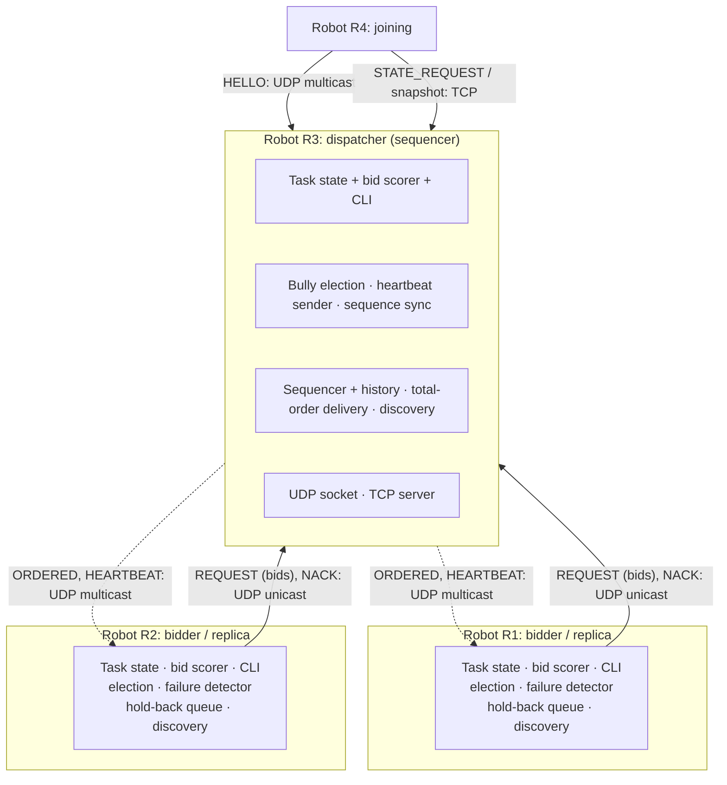
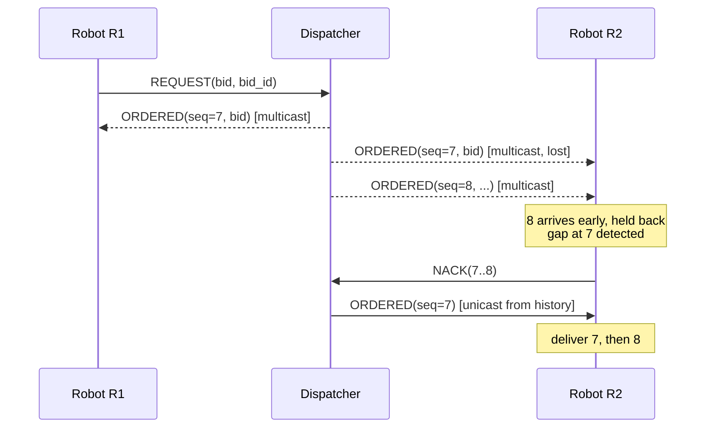
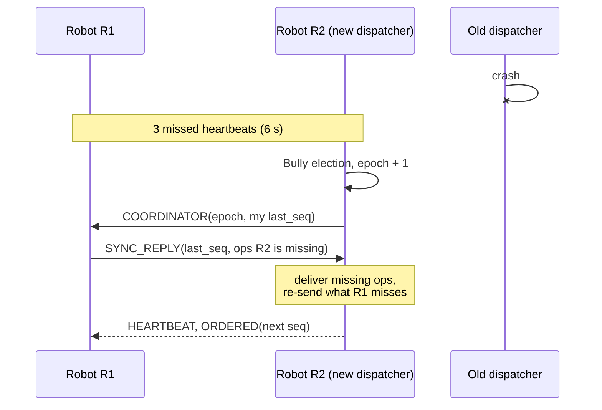

# Decentralized Robot Task Allocation

**Distributed Systems project, Group 48**

A peer-to-peer fleet of robots that share out tasks among themselves with no fixed server.
Every robot runs the same code. One robot is elected **dispatcher** and orders all bids so
that every robot picks the same winner. If the dispatcher crashes, the others notice, elect a new
one and carry on without losing or double-counting bids.

| Team member | Semester |
|---|---|
| Divyansh Sharma | WS5 |
| Ankita Samal | WS2 |
| Jasdeep Singh | WS2 |
| Bhavika Balapota | WS2 |

Python 3.9+, **standard library only**: nothing to install.

---

## Quick start

Open three terminals in the project folder:

```bash
python3 -m robot --id 10      # terminal 1: alone after 2 s -> becomes dispatcher
python3 -m robot --id 20      # terminal 2: joins, gets the state over TCP
python3 -m robot --id 30      # terminal 3: higher ID than the dispatcher -> wins an election
```

Then type in any terminal:

```text
post parcel 20 30      # post a task at (20,30); robots bid for 8 s
tasks                  # every robot shows the same board and the same winner
status                 # role, dispatcher, epoch, last sequence number, position
```

Press **Ctrl+C** on the dispatcher to crash it. About 6 s later the other robots elect a new
one, and any open task is still closed with a single winner.

### Command-line options

| Option | Meaning |
|---|---|
| *(none)* | Random ID from `uuid.uuid4()`, shown as 8 hex characters (e.g. `488d42f3`) |
| `--id N` | Fixed ID. Useful for showing the Bully election, where the highest ID wins |
| `--pos X Y` | Start position (default: random in 0–100). Affects the bids |
| `--loss P` | Drop a fraction `P` of incoming packets, e.g. `0.3`, to show recovery |
| `--log-level DEBUG` | Also log NACKs and retransmissions |

### CLI commands

| Command | Effect |
|---|---|
| `post NAME [X Y] [SECONDS]` | Post a task. Random position and 8 s bidding time if omitted |
| `tasks` | Show the replicated task board |
| `status` | Show this robot's role, dispatcher, epoch, last delivered sequence number, position, load |
| `view` | Show the membership view (robots found through discovery) |
| `help`, `quit` | Show help / stop |

---

## Architecture



The only fixed network value is the multicast group **`224.1.1.48:50048`**. Robot addresses,
ports and the dispatcher are all found at runtime.

### Code layout

| File | Responsibility |
|---|---|
| [`robot/config.py`](robot/config.py) | All timings and the multicast address |
| [`robot/messages.py`](robot/messages.py) | JSON wire format and message types |
| [`robot/transport.py`](robot/transport.py) | UDP multicast + unicast sockets, simulated packet loss |
| [`robot/reliable.py`](robot/reliable.py) | Reliable unicast: message IDs, ACK + retransmit, duplicate suppression |
| [`robot/discovery.py`](robot/discovery.py) | Membership view built only from HELLO traffic |
| [`robot/election.py`](robot/election.py) | Bully election with epoch numbers |
| [`robot/ordering.py`](robot/ordering.py) | Total order: hold-back queue, delivered log, gap detection |
| [`robot/tasks.py`](robot/tasks.py) | Replicated task board and bid scorer |
| [`robot/statetransfer.py`](robot/statetransfer.py) | TCP snapshot for joining robots |
| [`robot/node.py`](robot/node.py) | The robot: wires the modules together; heartbeat, failure detector, sequencer, failover sync |
| [`robot/__main__.py`](robot/__main__.py) | Command-line interface |
| [`scripts/scenarios.py`](scripts/scenarios.py) | Automated multi-process test scenarios |

---

## How it works

### 1. Dynamic discovery

1. A starting robot picks a random ID, joins the multicast group and sends **HELLO three
   times** in case one is lost.
2. Every running robot answers with **HELLO_REPLY**, which contains its ID, the current
   dispatcher and the current epoch. The new robot builds its membership view from these replies, never from a config file.
3. Robots repeat HELLO every **5 s**. A robot not heard from for **15 s** is removed from the view.
4. If nobody answers within **2 s**, the robot is alone and becomes dispatcher of a fleet of one.
5. Before taking part in task allocation, a joining robot fetches the current state from the
   dispatcher over **TCP** (see 6).

### 2. Reliable unicast

UDP may lose packets, so protocol messages that must arrive (election, COORDINATOR,
SYNC_REPLY) carry a per-sender message ID:

- The receiver always replies with an **ACK**, even for duplicates, in case the earlier ACK was lost.
- The sender retransmits every 0.4 s and gives up after 7 tries. The silent robot is then
  suspected crashed and removed from the view.
- The receiver remembers `(sender, message ID)` and processes each message only once.

### 3. Failure detection and Bully election

- The dispatcher multicasts a **HEARTBEAT every 2 s**. **3 missed heartbeats (6 s)** mean it has crashed.
- An election starts when there is no dispatcher, when the dispatcher stops sending heartbeats, or when a robot with a
  higher ID than the dispatcher joins.
- The robot starting the election sends **ELECTION** to every higher ID. A higher robot replies **ANSWER** and
  takes over the election. With no ANSWER within **2 s**, the robot wins. If an ANSWER came but no **COORDINATOR**
  arrives within **5 s**, the election restarts. The highest live ID always wins.
- **Epochs:** the winner's epoch is the highest epoch seen + 1. Every message carries the
  sender's epoch, and dispatcher messages from an older epoch are ignored. An old dispatcher
  that comes back sees the higher epoch and steps down. If two robots are dispatcher in the
  same epoch (they started at the same moment), the higher ID wins and the other one
  fetches the state again.

### 4. Reliable total-order multicast

Bids from different robots are sent independently and at the same time. With FIFO or causal
order, robots could process them in different orders and choose different winners, sending
two robots to the same task. So we use **total ordering, with the dispatcher as sequencer**:



- Robots send operations (OPEN, BID, CLOSE) to the dispatcher. The dispatcher gives each a **global
  sequence number** and multicasts it.
- Every robot delivers operations **strictly in sequence order**. Operations that arrive early wait in a **hold-back
  queue**. On a gap the robot sends a **NACK** and the dispatcher resends from its history.
- Heartbeats carry the **latest sequence number**, so a lost *last* message is also detected.
- A robot resends its own operation (with the same `op_id` / bid ID) every 1 s until it sees it
  in the ordered stream. Because of the ID, a bid is **never counted twice**.

### 5. Task allocation

| Operation | Effect when delivered |
|---|---|
| `open` | Task becomes open. Every live robot computes a bid and submits it |
| `bid` | Bid recorded, but only if the task is still open |
| `close` | Bidding ends. Lowest cost wins; ties go to the lowest robot ID |

- **Bid cost** = distance to the task + 15 × number of tasks the robot already has. The
  winner moves to the task position, so its later bids change.
- Bidding is closed by a **CLOSE operation ordered like the bids**. Only bids ordered before
  the CLOSE count, so the result is the same on every robot **without synchronized clocks**.
- A robot learns whether its bid was accepted only when it delivers that bid itself from
  the ordered stream.

### 6. State transfer (TCP)

A joining robot asks the dispatcher for a snapshot over TCP: the full ordered log and the last
sequence number. It replays the log to rebuild the task board. ORDERED messages that arrive while
it waits are kept in the hold-back queue and delivered afterwards.

### 7. Dispatcher failover



1. The new dispatcher sends **COORDINATOR** to every robot, including its own last delivered
   sequence number.
2. Each robot replies with **SYNC_REPLY**: its last delivered sequence number and any operations the new
   dispatcher has not delivered.
3. The new dispatcher delivers those operations, resends whatever the most-behind robot is missing, and
   continues numbering from there. **Nothing any survivor delivered is lost or applied twice.**
4. Open tasks keep their **remaining bidding time**. Every robot measures the deadline from its own
   delivery of OPEN, so the new dispatcher closes the task when its own timer expires.

A robot that restarts after a crash joins as a **new member** with a new ID and fetches a snapshot.

---

## Timing parameters

All in [`robot/config.py`](robot/config.py):

| Parameter | Value |
|---|---|
| Initial HELLOs | 3 × (0.2 s apart) |
| Discovery wait (alone → dispatcher) | 2 s |
| HELLO interval / member timeout | 5 s / 15 s |
| Heartbeat interval / failure detection | 2 s / 6 s (3 missed) |
| Election ANSWER / COORDINATOR timeout | 2 s / 5 s |
| Reliable unicast retransmit | every 0.4 s, 7 tries |
| Own operation resubmission | every 1 s until delivered |
| Failover sync timeout | 3 s |
| Default bidding time | 8 s |

---

## Testing

```bash
python3 scripts/scenarios.py              # all four scenarios (~2 min)
python3 scripts/scenarios.py failover     # just one: basic | loss | failover | join
```

Each scenario starts real robot processes, controls them through their CLI, and checks that all
surviving robots log identical `RESULT task=… winner=…` lines. Logs are written to
`logs/<scenario>/robot-<id>.log`.

| Scenario | What it shows | Result |
|---|---|---|
| `basic` | Discovery, election on a higher-ID join, bidding; the closest robot wins | ✅ Pass |
| `loss` | 30% packet loss on all robots; NACK + retransmission keep the order identical | ✅ Pass |
| `failover` | Dispatcher killed mid-bidding: detection, election, sync, remaining bid time | ✅ Pass |
| `join` | Late joiner gets state over TCP; higher-ID joiner wins, old dispatcher steps down | ✅ Pass |

### Running on several machines

Run `python3 -m robot` on each machine on the **same network**. Notes:

- Many university or corporate Wi-Fi networks block multicast. A phone hotspot or home router usually works.
- On macOS, allow Python to accept incoming connections when asked. TCP state transfer needs it.

---

## Fault model and limitations

- **Crash-stop failures** only. Robots do not behave maliciously.
- A task stays assigned to its winner even if that robot crashes later. There is no re-allocation.
- SYNC_REPLY is a single UDP datagram. With a very long log (hundreds of tasks) and a
  brand-new robot winning an election, it could exceed 64 KB.
- Every robot keeps the full operation log. That is fine for a demo-sized fleet, but there is no garbage collection.
